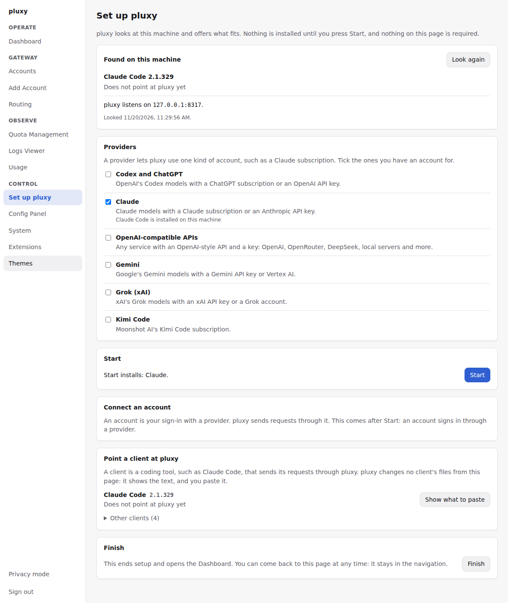

# pluxy
(WIP)
pluxy (plug + proxy) is a proxy that runs on your machine and serves the OpenAI, Anthropic, Gemini
and Codex APIs from the accounts you already have: subscription sign-ins and API keys. Your coding
tools talk to pluxy, and pluxy picks an account for each request.

## What it is for

If you run coding agents on subscription accounts, you have probably met these:

- **An account hits its limit in the middle of a task.** pluxy holds several accounts for a
  provider. When one is refused for its rate or usage limit, the request goes to the next account
  that serves the model, as long as no part of the reply has reached the client.
- **An account stays blocked after its limit has reset.** pluxy blocks an account for as long as
  the provider said. While a long block lasts, pluxy checks every 15 minutes whether the limit is
  still full, and ends the block when it is not. `pluxy account list` says why each account is
  blocked and until when; `pluxy account clear <id>` ends a block now.
- **You cannot see what is left.** `pluxy account quota <id>` and the panel's Quota page show
  each account's limits as the provider reports them. `pluxy usage` counts requests and tokens by
  model, account, client key or provider, from a record kept on disk.
- **Setup means writing a config file by hand.** The first start writes the config. A setup page
  then looks at the machine, offers the providers that fit what it found, and installs only the
  ones you pick.
- **Every tool wants different settings.** `pluxy client connect <tool>` writes them into Claude
  Code's or Codex's settings, and `pluxy client disconnect <tool>` puts the file back (or, when the
  file changed since, takes back only the settings connect wrote);
  `pluxy client show <tool>` prints what to paste into Claude Code, Codex, OpenCode, Pi or Oh My Pi.

pluxy has three parts: the core (the proxy itself, a Go program), a web panel the core serves at
`/panel/`, and a desktop app that runs or connects to a core (Linux only for now). Each kind of
account is served by a provider extension, a separate program the core starts: Claude, Codex and
ChatGPT, Gemini, Grok, Kimi Code, Meta Muse, Devin, and any OpenAI-compatible API.



## Quick start

There is no release to download yet, so the quick start builds pluxy from source. It ends with
one request sent through pluxy and counted in its usage record.

You need [Git](https://git-scm.com/downloads), [Go](https://go.dev/dl/) 1.26.11 or newer and
[Bun](https://bun.sh) 1.4.3. The commands are the same on Linux and macOS. On Windows, run them
in Git Bash, and write `pluxy.exe` wherever a command below says `pluxy`.

### 1. Build

```bash
git clone https://github.com/stdotwork/pluxy.git pluxy-src
cd pluxy-src/next
go generate ./internal/panel
go run ./cmd/pluxy-pack -out ~/pluxy
go build -o ~/pluxy/pluxy ./cmd/pluxy
```

`go generate` builds the web panel, which the program carries inside it. `pluxy-pack` packs the
provider extensions into `~/pluxy/bundled`, where pluxy looks for them. `go build` builds pluxy
itself. The source stays in `pluxy-src`, and the program is in `~/pluxy`. What pluxy writes from
here on (its config, accounts, logs and usage record) goes in its home folder: on Linux
`~/.local/share/pluxy`, on macOS `~/Library/Application Support/pluxy`, on Windows
`%LOCALAPPDATA%\pluxy`.

### 2. Start it

```bash
cd ~/pluxy
./pluxy serve
```

The first time, pluxy writes its config, `config.json`, in its home folder, and prints, among
other lines, where it is and its address:

```text
pluxy: config: /home/you/.local/share/pluxy/config.json (pluxy's home)
pluxy: first start: wrote a new config, /home/you/.local/share/pluxy/config.json, listening on 127.0.0.1:8317; its client key and management key are in that file
pluxy: listening on http://127.0.0.1:8317
```

The port is 8317, or a free one when 8317 is taken. `config.json` holds two keys that pluxy made
for you. The `management_key` signs you in to the panel; `./pluxy key management --show-key`
prints it. The one under `client_keys` is what a client sends with each request. Only your user
can read the file.

Leave pluxy running and open a second terminal in `~/pluxy` for the rest. The `pluxy` commands
find the address and the management key in pluxy's home from any folder; a `config.json` in the
folder they run in comes first ([pluxy's home](next/README.md#pluxys-home) has the rules).

### 3. Install a provider

Nothing is installed at first. Open `http://127.0.0.1:8317/panel/` in a browser and sign in with
the management key. The panel opens on **Set up pluxy**, which lists what it found on the machine
(coding tools and their sign-ins) and the providers you can install. Tick the providers you have
an account for and press **Start**.

The same from the terminal:

```bash
./pluxy setup
```

It prints what it found and offers to install the providers it suggests. To install any other,
name it: `./pluxy ext available` lists them, and `./pluxy ext install pluxy/claude` installs one.

### 4. Connect an account

On the same page, **Connect an account** now lists the ways to sign in that the installed
providers offer, such as "Claude subscription" (a sign-in in the browser) or "API key". Press **Start** on one, fill in what it asks for and press **Continue**. The **Add an account** page does the same later.
From a terminal, `./pluxy account add <provider>` does the same, and `./pluxy account methods`
lists the providers and their ways to sign in.

Check that the account answers:

```bash
./pluxy account list
./pluxy account test <account-id>
```

`account test` sends one small request through the account and prints the reply.

### 5. Point a client at pluxy

```bash
./pluxy client connect claude-code
```

This writes Claude Code's settings (`~/.claude/settings.json`) with a client key made for it, and
keeps the file as it was: `./pluxy client disconnect claude-code` puts it back, or, when the file
changed since, takes back only the settings connect wrote and keeps the rest. To paste the
settings yourself instead, `./pluxy client show claude-code` prints the lines to put in the tool's
config file, with `<client-key>` where your client key goes. The other tools are `codex`, `opencode`, `pi` and `omp`; [docs/clients.md](docs/clients.md)
has each one's settings, and the base URLs for any other client.

### 6. Send a request and see it counted

`./pluxy model list` prints the models your accounts serve. Send one of them a request with the
client key from pluxy's `config.json`:

```bash
curl http://127.0.0.1:8317/v1/chat/completions \
  -H "Authorization: Bearer <client-key>" \
  -H "Content-Type: application/json" \
  -d '{"model": "<model-id>", "messages": [{"role": "user", "content": "Say hello"}]}'
```

Then look at the usage record:

```bash
./pluxy usage
```

It shows one request with its tokens, under the model you asked for. The panel's Activity page shows
the same record. `./pluxy help` lists every command.

## Where to read more

| You want to | Read |
| --- | --- |
| Set up a coding tool or another client | [docs/clients.md](docs/clients.md) |
| Move from CLIProxyAPI | [docs/moving-from-cpa.md](docs/moving-from-cpa.md) |
| Fix a problem or find out why a request failed | [docs/troubleshooting.md](docs/troubleshooting.md) |
| Run pluxy in a container | [next/README.md, "Run it in a container"](next/README.md#run-it-in-a-container) |
| Look up a config setting, a provider's options, routing, logs or the management API | [next/README.md](next/README.md) |
| Use the desktop app | [next/app/README.md](next/app/README.md) |
| Write a provider extension | [next/protocol/TUTORIAL.md](next/protocol/TUTORIAL.md) |
| Know why pluxy is built this way | [docs/design.md](docs/design.md) |
| Know what pluxy costs in time and memory | [docs/perf.md](docs/perf.md) |
| Build, test or change pluxy | [AGENTS.md](AGENTS.md) |

## What is in this repository

Everything is in `next/`:

| Folder | Component |
| --- | --- |
| `next/` | The core, its extension protocol and the provider extensions ([README](next/README.md)) |
| `next/ui/` | The UI kit: the web panel, and the pages the desktop app shares with it ([README](next/ui/README.md)) |
| `next/app/` | The desktop app ([README](next/app/README.md)) |

## Credits and license

pluxy started as Soul4723's forks of router-for-me's
[CLIProxyAPI](https://github.com/router-for-me/CLIProxyAPI) core,
[EasyCLIProxyAPI](https://github.com/router-for-me/EasyCLIProxyAPI) desktop app and
[Cli-Proxy-API-Management-Center](https://github.com/router-for-me/Cli-Proxy-API-Management-Center)
web panel. The new core, panel and desktop app in `next/` replaced the three forks, which have been
removed. Their MIT notices, the Pi adapter's in `next/app-tools/pi-setup/adapter/`, and the files
`next/` keeps or adapts from each are in [THIRD_PARTY_NOTICES.md](THIRD_PARTY_NOTICES.md). The root
license is not decided yet.
