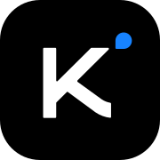

# CLI Proxy API

English | [中文](README_CN.md) | [日本語](README_JA.md)

CLIProxyAPI is a proxy server that provides OpenAI/Gemini/Claude/Codex/Grok compatible API interfaces for CLI.

You can access the following providers locally and with multiple CLI accounts through any OpenAI (including Responses), Gemini (including Interactions), or Claude-compatible client or SDK.

<table>
<tbody>
    <tr>
        <th align="center" width="100">Provider</th>
        <th align="center">Description</th>
    </tr>
    <tr>
        <td align="center"></td>
        <td>Kimi series models (Kimi K3.1 Pro, K3.1 Pro Highspeed, K3, K2.8 Preview, etc.). <a href="https://platform.kimi.ai/docs/guide/kimi-k3-quickstart">Kimi K3</a> is Moonshot AI’s previous-generation flagship and the world’s first open 3T-class model. With 2.8 trillion parameters, native vision, and a 1-million-token context window, K3 is built for long-horizon coding, knowledge work, and reasoning. CLIProxyAPI supports Kimi through OAuth or compatible API interfaces. Try a <strong>Kimi Code plan</strong> (<a href="https://www.kimi.com/code">中文站</a> | <a href="https://www.kimi.ai/code">Global</a>), or get an <strong>API key</strong> from the Kimi Open Platform (<a href="https://platform.kimi.com">中文站</a> | <a href="https://platform.kimi.ai">Global</a>).</td>
    </tr>
    <tr>
        <td align="center"></td>
        <td>OpenAI GPT-6 models (GPT-6 Astra, GPT-6.1 Sol, GPT-6.1 Terra, GPT-6 Luna), including access through Codex OAuth. Astra is the flagship for complex reasoning and coding, Sol balances capability and cost, Terra focuses on visual reasoning and computer use, and Luna handles focused, high-volume work.</td>
    </tr>
    <tr>
        <td align="center"></td>
        <td>Anthropic Claude models (Claude Fable 5.1, Claude Opus 5.5, Claude Sonnet 5.5, Claude Haiku 5.5). Fable 5.1 is built for ambitious, long-running coding and knowledge work; Opus 5.5 brings strong agentic coding at a lower cost.</td>
    </tr>
    <tr>
        <td align="center"></td>
        <td>Google Gemini models include Gemini 4 Argon and Gemini 3.8 Flash. CLIProxyAPI supports Gemini API, AI Studio, Vertex AI, Gemini CLI, and Antigravity accounts; model availability varies by channel. Gemini 3.8 Flash is Google's latest Flash model for long-horizon software engineering and agentic workflows. Antigravity's <a href="https://antigravity.google/docs/models/">official model availability</a> lists Claude Sonnet 5.5 (thinking) and Claude Opus 5.5 (thinking) for Google AI Pro (non-trial), Google AI Ultra, and Enterprise.</td>
    </tr>
    <tr>
        <td align="center"></td>
        <td>xAI Grok models (Grok 4.7, Grok 4.7 Build Fast, etc.). Grok 4.7 is SpaceXAI's latest model for coding, agentic tasks, and knowledge work.</td>
    </tr>
    <tr>
        <td align="center"></td>
        <td>Meta Muse models (Muse Wonder Full, Muse Wonder, Muse Spark 1.3, etc.). CLIProxyAPI supports Muse Code accounts through Meta login and Meta Model API keys, with Muse Spark 1.3 for coding and agentic workflows. Meta has announced Muse Wonder for Meta Model API and Muse Code, and Muse Wonder Full for Muse Code subscribers.</td>
    </tr>
    <tr>
        <td align="center"><a href="https://devin.ai/cli">Devin</a></td>
        <td>Devin models (SWE-2, GPT-6 Astra, Claude Fable 5.1, etc.). Connect a Devin account with <code>--devin-login</code> to route the models available to that account.</td>
    </tr>
</tbody>
</table>

## Overview

- OpenAI/Gemini/Claude/Grok compatible API endpoints for CLI models
- OpenAI Codex support (GPT models) via OAuth login
- Claude Code support via OAuth login
- Grok Build support via OAuth login
- Streaming, non-streaming, and WebSocket responses where supported
- Function calling/tools support
- Multimodal input support (text and images)
- Multiple accounts with round-robin load balancing (Gemini, OpenAI, Claude, Grok)
- Simple CLI authentication flows (Gemini, OpenAI, Claude, Grok)
- Generative Language API Key support
- AI Studio Build multi-account load balancing
- Claude Code multi-account load balancing
- OpenAI Codex multi-account load balancing
- Grok Build multi-account load balancing
- OpenAI-compatible upstream providers via config (e.g., OpenRouter)
- Reusable Go SDK for embedding the proxy (see `docs/sdk-usage.md`)

## Getting Started

CLIProxyAPI Guides: [https://help.router-for.me/](https://help.router-for.me/)

[Claude Code with a Codex backend](examples/claude-code-codex/README.md): optional visible progress, classifier routing, image-tool pass-through, and latency diagnostics.

## Management API

see [MANAGEMENT_API.md](https://help.router-for.me/management/api)

## SDK Docs

- Usage: [docs/sdk-usage.md](docs/sdk-usage.md)
- Advanced (executors & translators): [docs/sdk-advanced.md](docs/sdk-advanced.md)
- Access: [docs/sdk-access.md](docs/sdk-access.md)
- Watcher: [docs/sdk-watcher.md](docs/sdk-watcher.md)
- Custom Provider Example: `examples/custom-provider`

## Contributing

See the [pluxy repository root](../README.md) for repository information.

## License

This project is licensed under the MIT License - see the [LICENSE](LICENSE) file for details.
