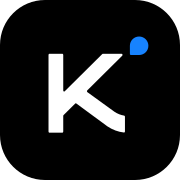

# CLI Proxy API

[English](README.md) | 中文 | [日本語](README_JA.md)

CLIProxyAPI 是一个为 CLI 提供 OpenAI/Gemini/Claude/Codex/Grok 兼容 API 接口的代理服务器。

您可以通过任何与 OpenAI（包括 Responses）、Gemini（包括 Interactions）或 Claude 兼容的客户端或 SDK，以本地方式或多 CLI 账户访问以下提供商。

<table>
<tbody>
    <tr>
        <th align="center" width="100">提供商</th>
        <th align="center">说明</th>
    </tr>
    <tr>
        <td align="center"></td>
        <td>Kimi 系列模型（Kimi K3.1 Pro、K3.1 Pro Highspeed、K3、K2.8 Preview 等）。<a href="https://platform.kimi.com/docs/guide/kimi-k3-quickstart">Kimi K3</a> 是 Moonshot AI 的上一代旗舰模型，也是全球首个开源 3T 级模型。K3 拥有 2.8T 参数、原生视觉能力与 100 万 Token 上下文，面向长周期编码、知识工作与推理任务。CLIProxyAPI 支持通过 OAuth 或兼容 API 接入 Kimi。立即体验 <strong>Kimi Code 订阅</strong>（<a href="https://www.kimi.com/code">中文站</a>｜<a href="https://www.kimi.ai/code">Global</a>），或前往 Kimi 开放平台（<a href="https://platform.kimi.com">中文站</a>｜<a href="https://platform.kimi.ai">Global</a>）获取 <strong>API Key</strong>。</td>
    </tr>
    <tr>
        <td align="center"></td>
        <td>OpenAI GPT-6 系列模型（GPT-6 Astra、GPT-6.1 Sol、GPT-6.1 Terra、GPT-6 Luna），也支持通过 Codex OAuth 接入。Astra 适合复杂推理与编程，Sol 兼顾能力与成本，Terra 专注于视觉推理与计算机操作，Luna 适合高吞吐量的明确任务。</td>
    </tr>
    <tr>
        <td align="center"></td>
        <td>Anthropic Claude 系列模型（Claude Fable 5.1、Claude Opus 5.5、Claude Sonnet 5.5、Claude Haiku 5.5）。Fable 5.1 适合长周期编程与知识工作；Opus 5.5 以更低成本提供强大的智能体编程能力。</td>
    </tr>
    <tr>
        <td align="center"></td>
        <td>Google Gemini 系列模型包括 Gemini 4 Argon 和 Gemini 3.8 Flash。CLIProxyAPI 支持 Gemini API、AI Studio、Vertex AI、Gemini CLI 与 Antigravity 账户；可用模型因渠道而异。Gemini 3.8 Flash 是 Google 面向长周期软件工程与智能体工作流推出的最新 Flash 模型。Antigravity 的<a href="https://antigravity.google/docs/models/">官方模型可用性文档</a>列明，Claude Sonnet 5.5（thinking）和 Claude Opus 5.5（thinking）向 Google AI Pro（非试用订阅）、Google AI Ultra 和 Enterprise 开放。</td>
    </tr>
    <tr>
        <td align="center"></td>
        <td>xAI Grok 系列模型（Grok 4.7、Grok 4.7 Build Fast 等）。Grok 4.7 是 SpaceXAI 面向编程、智能体任务与知识工作推出的最新模型。</td>
    </tr>
    <tr>
        <td align="center"></td>
        <td>Meta Muse 系列模型（Muse Wonder Full、Muse Wonder、Muse Spark 1.3 等）。CLIProxyAPI 支持通过 Meta 登录接入 Muse Code 账户，也支持 Meta Model API Key；Muse Spark 1.3 面向编程与智能体工作流。Meta 已宣布 Muse Wonder 可通过 Meta Model API 和 Muse Code 使用，Muse Wonder Full 则面向 Muse Code 订阅用户提供。</td>
    </tr>
    <tr>
        <td align="center"><a href="https://devin.ai/cli">Devin</a></td>
        <td>Devin 提供的模型（SWE-2、GPT-6 Astra、Claude Fable 5.1 等）。使用 <code>--devin-login</code> 连接 Devin 账户，即可路由该账户可用的模型。</td>
    </tr>
</tbody>
</table>

## 功能特性

- 为 CLI 模型提供 OpenAI/Gemini/Claude/Codex/Grok 兼容的 API 端点
- 新增 OpenAI Codex（GPT 系列）支持（OAuth 登录）
- 新增 Claude Code 支持（OAuth 登录）
- 新增 Grok Build 支持（OAuth 登录）
- 支持流式、非流式响应，以及受支持场景下的 WebSocket 响应
- 函数调用/工具支持
- 多模态输入（文本、图片）
- 多账户支持与轮询负载均衡（Gemini、OpenAI、Claude、Grok）
- 简单的 CLI 身份验证流程（Gemini、OpenAI、Claude、Grok）
- 支持 Gemini AIStudio API 密钥
- 支持 AI Studio Build 多账户轮询
- 支持 Claude Code 多账户轮询
- 支持 OpenAI Codex 多账户轮询
- 支持 Grok Build 多账户轮询
- 通过配置接入上游 OpenAI 兼容提供商（例如 OpenRouter）
- 可复用的 Go SDK（见 `docs/sdk-usage_CN.md`）

## 新手入门

CLIProxyAPI 用户手册： [https://help.router-for.me/](https://help.router-for.me/cn/)

## 管理 API 文档

请参见 [MANAGEMENT_API_CN.md](https://help.router-for.me/cn/management/api)

## SDK 文档

- 使用文档：[docs/sdk-usage_CN.md](docs/sdk-usage_CN.md)
- 高级（执行器与翻译器）：[docs/sdk-advanced_CN.md](docs/sdk-advanced_CN.md)
- 认证: [docs/sdk-access_CN.md](docs/sdk-access_CN.md)
- 凭据加载/更新: [docs/sdk-watcher_CN.md](docs/sdk-watcher_CN.md)
- 自定义 Provider 示例：`examples/custom-provider`

## 贡献

仓库信息请参阅 [pluxy 仓库根目录](../README.md)。

## 许可证

此项目根据 MIT 许可证授权 - 有关详细信息，请参阅 [LICENSE](LICENSE) 文件。
